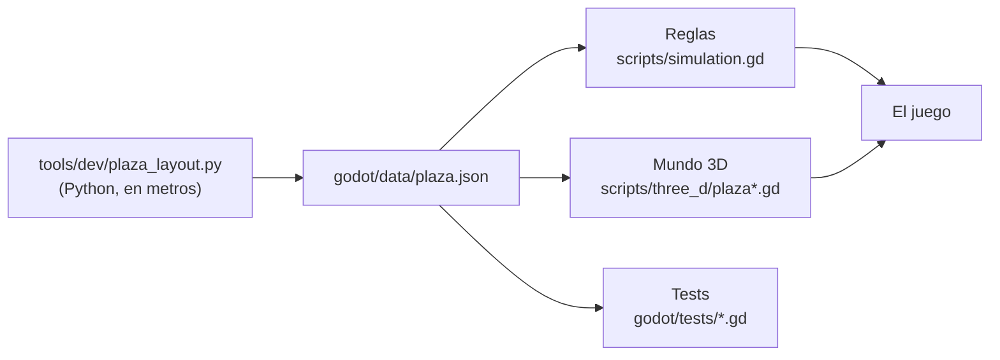

# Cómo se hizo Hora Cero

*[English version](HOW_IT_WAS_MADE.md)*

Hora Cero · Invasión Buenos Aires es un juego chico hecho con mucho cuidado: dos niveles, una plaza y un barrio, una
noche de 1958. Esto cuenta cómo se hizo, para quien lo juega, para quien quiera meterle mano y para quien tenga
curiosidad por hacer juegos con una IA.

Kit de diseño en Figma: [Hora Cero · kit](https://www.figma.com/design/Y03Bhe1LF6GyW3VJMOYqZN)

## Quién hizo qué

- **La idea, la dirección, el diseño y cada decisión**: Alejandro Vizio (Ale).
- **El código, el 3D procedural, las texturas, los niveles, los tests, la versión web y los tráilers**: Claude, la IA
  de Anthropic, trabajando en Claude Cowork, con Ale revisando cada paso y marcando el rumbo. Ale pedía, miraba,
  jugaba, corregía; Claude escribía, probaba y volvía a probar.
- **Los modelos de Juan Salvo, del cascarudo y de los vehículos**: amigos de Ale, con su permiso (ver más abajo).
- **La historieta**: Héctor Germán Oesterheld y Francisco Solano López, publicada en *Hora Cero Semanal* desde 1957.
  Sus personajes y criaturas se usan con el permiso de sus derechohabientes.

El juego no arrancó de cero: salió del motor de un juego anterior de Ale, de sigilo con un grupo chico. De ahí vienen
el motor de reglas (`godot/scripts/simulation.gd`), el HUD táctil y buena parte de la capa 3D. Todo lo demás se hizo
para Hora Cero.

## Primero, investigar

Antes de construir nada hubo que saber cómo era Buenos Aires en 1958: los edificios de la Plaza de Mayo y cómo
miraban a la plaza, los tranvías de Rivadavia con sus dos vías, los colectivos, los carteles de las calles, cómo
hablaba la gente. Eso quedó en el juego de dos maneras:

- en el mundo: la plaza es la de verdad, simplificada (el Cabildo con sus arcos y su torre, la Catedral con su
  pórtico de doce columnas, la Casa Rosada, el Banco Nación, la Pirámide, el monumento a Belgrano, la boca del subte
  de la Línea A), y La Boca tiene sus conventillos, su trinchera del ferrocarril y el puente transbordador;
- en las páginas de «la historia real» que se abren al ganar cada nivel (`history` en los datos del nivel), con lo
  que es cierto de cada lugar. Como dice el pie de una de ellas: la noche de la nevada es inventada; la plaza, no.

Ninguna foto ni plano se copió: todo se dibujó de nuevo a partir de cómo eran esos lugares.

## Los niveles son programas

Cada nivel es un script de Python que escribe un archivo de datos: `tools/dev/plaza_layout.py` escribe
`godot/data/plaza.json`, y `tools/dev/riachuelo_layout.py` escribe `godot/data/riachuelo.json`. Ahí está todo:
dónde está cada pared, cada refugio, cada farol, quién patrulla por dónde, cuándo vienen las ráfagas de nieve,
cuándo entra Juan Salvo, los textos. El script trabaja en metros y los pasa a las unidades del juego (32 por metro).
La regla es simple: se edita el script, nunca el JSON.

Del mismo archivo leen las dos mitades del juego: las reglas (quién ve a quién, quién se cae en la nieve, qué se
puede abrir) y el constructor del mundo 3D. Por eso el decorado y las reglas nunca se contradicen: si una pared
está en el mapa, está en el mundo, y está en el mismo lugar.

## El mundo, construido con código

No hay escenas modeladas a mano. Cuando arranca un nivel, el juego construye el mundo con GDScript a partir de los
datos:

- **El kit de la Plaza de Mayo** (`plaza_kit.gd`, `plaza_kit_buildings.gd`, `plaza_kit_props.gd`) arma cada
  edificio con piezas simples: la Casa Rosada, el Cabildo, la Catedral, el Banco Nación, la Pirámide, el
  monumento a Belgrano, los faroles, las palmeras, los bancos, el tranvía y el colectivo propios del kit.
- **La ciudad alrededor** (`plaza_city.gd`) son manzanas de Buenos Aires que siguen más allá del mapa, con la Avenida
  de Mayo y la Diagonal Norte; **los detalles** (`plaza_details.gd`) son las chapas, los diarios, el filete, las
  mesas de café.
- **La Boca** (`boca.gd`) levanta los conventillos, la trinchera, los puentes, el muelle y el puente transbordador
  con su barquilla.

Todo se junta en pocas mallas grandes, para que alcance con un teléfono: la vista de arranque de la plaza se dibuja
con unos pocos cientos de llamadas de dibujo.

**La Casa Rosada envejecida.** No es una pintura lisa: es un palacio de revoque a la cal de la década de 1890,
con el revoque desparejo, parches y fisuras finas, la piedra clara de las molduras y cornisas, y el tiempo encima: una
capa de mugre a un pelo de las paredes (`plaza_grime.gdshader`) con las chorreaduras de la lluvia bajo cada alféizar y
balcón, el hollín y la humedad bajo las cornisas y la humedad que sube del piso. Las manchas grandes del revoque se
dibujan en coordenadas del mundo (`plaza_walls.gdshader`), para que no se vea la repetición en un frente de 96 m.

**Las palmeras** son fénix canarias, como las que plantó Thays en la plaza a principios del siglo XX (en 1958 tenían
unos 55 años, más bajas que hoy): el tronco con los rombos de las hojas viejas, una copa densa de hojas largas que se
arquean, las más secas colgando, y nieve en lo que mira para arriba. Cuando alguien queda debajo, la copa se vuelve
transparente para que se lo vea (`plaza_palm_ghost.gdshader`), y el tronco sigue entero.

**Las texturas** salen de scripts de Python (`tools/gen_plaza_textures.py`, `tools/gen_boca_textures.py` y los
demás `tools/gen_*_textures.py`): piedra, revoque, chapa, adoquines, carteles, todo pintado por código.

**La nieve** es casi toda shaders: el piso que se va blanqueando con el reloj de las reglas, el barro gris en las
calles con tránsito, las huellas que la nieve nueva va tapando (`plaza_ground.gdshader`), los montones contra las
paredes (`plaza_drift.gdshader`) y los copos que caen, que no son partículas sino quads en una multimesh que se
mueven en la placa de video (`plaza_snowfall.gdshader`).

**El modo historieta** («Modo historieta» en Ajustes) es un post-proceso: una pasada de pantalla completa dibuja los
contornos y los rayados en tinta (`ink_lines.gdshader`) y otra imprime todo sobre papel de diario
(`ink_paper.gdshader`).

## Los personajes

**Los cuatro vecinos** (Hornero, Lechuza, Benteveo y Biguá, con nombres de pájaros del Río de la Plata) son
originales del juego, igual que la gente de la plaza, los guardias y el pasajero de La Boca. Sus cuerpos salen de
los assets libres (CC0) de MakeHuman: `tools/mh/mhbake.py` deforma la malla base según cada uno (edad, contextura,
cara), le pone la ropa, el pelo y los ojos, y la acomoda al esqueleto del juego, de 19 huesos. La piel de cada uno
se «curte» por script (sol, arrugas, barba de un día, mugre) sobre la textura original. En el juego no hay
animaciones grabadas: `operative.gd` pone el esqueleto en pose a cada cuadro a partir de lo que dicen las reglas
(el paso con los pies bien apoyados, agacharse, cargar a alguien, caer).

Los retratos pintados de los vecinos en el HUD se hicieron con el generador de imágenes de Figma, en el estilo del resto del atlas
de fotos.

**Juan Salvo y el cascarudo** son modelos que hicieron amigos de Ale. Entran por el «paquete de arte»
(`godot/art_pack/`, explicado en [ART_PACK.md](ART_PACK.md)), y para el juego se trabajaron encima sin cambiarles lo
que son. Si esos modelos no están, el juego muestra figuras neutras y se juega igual.

### Juan Salvo, refinado

El modelo de los amigos es chico y anguloso: unos 2.000 triángulos de cajas y prismas y un atlas de 512 px. Queda
intacto como fuente (`art/juan_salvo/source/`), y `python3 tools/art_pack.py refine-person` (`tools/person_refine.py`)
saca de él el Juan Salvo del juego, a la altura de los vecinos: las mismas piezas, la misma silueta, los mismos colores,
el mismo esqueleto y las mismas animaciones, pero con brazos, piernas, capucha y saco redondeados (los bordes que tienen
que ser netos, como el ruedo, las suelas o el visor, siguen netos), unos 15.800 triángulos, el atlas rehecho a 2048 px
con la trama de cada tela, y la oclusión, el barro, el desgaste y los pliegues guardados en los vértices. En el juego lo
viste el mismo shader que a la ropa de los vecinos (`art_model.gdshader`).

Trae sus animaciones de quieto, caminar y correr. El juego las mezcla según su velocidad y, para lo que no cubren, le
gira los huesos en el momento: agacharse, cargar a alguien al hombro, apuntar y disparar el rifle, caer y levantarse
(`rig_person.gd`). Camina al paso y con la cadencia del grupo (unos tres pasos por segundo, sin que el pie apoyado
patine) y corre solo cuando corre de verdad.

Su retrato del HUD no es un dibujo: es un render del modelo en el motor, de tres cuartos y con la luz dura de un farol
(la cara es un dibujo chico sobre una placa, así que el retrato la deja en sombra y muestra el visor y el respirador),
pasado por un filtro al óleo con el fondo, la tela y el color de los retratos de los vecinos, para que los cinco se vean
como una serie (`tools/dev/salvo_portrait.gd` y `salvo_portrait_paint.py`). Nada se pinta a mano encima.

### El cascarudo, con patas

El cascarudo de los amigos es una escultura de una pieza, sin esqueleto (45.000 triángulos). Para que camine,
`python3 tools/art_pack.py rig-creature` (`tools/creature_rig.py`) le pone un esqueleto sin mover ni un vértice: busca
sus seis patas desde el piso (cada punto que toca el suelo es un pie o una punta de pinza), sube por la superficie hasta
donde la pata se abre al cuerpo, pone cadera, rodilla y tobillo donde dobla, y reparte los pesos suave en cada
articulación para que nada se rompa. También le guarda en los vértices la oclusión (las grietas y la panza oscuras) y lo
convexo (los bordes gastados). De lejos se dibuja una copia de unos 13.500 triángulos con el mismo esqueleto.

El paso lo calcula el juego (`creature_body.gd`): camina en trípode alterno, como un insecto, según lo que anduvo de
verdad (cada pie se levanta, va adelante y se apoya, y el que está apoyado no patina), arrastra los pies cuando gira en
el lugar, respira con el caparazón, levanta las pinzas al embestir y al pararse sobre alguien, se tambalea con un
disparo y, al morir, se da vuelta panza arriba y encoge las patas.

### El caparazón

El cascarudo tiene su propio shader (`art_chitin.gdshader`) para que se lea como el caparazón de un bicho y no como
plástico, sin cambiarle la forma ni el tono de su color: un oliva pardo muy oscuro, estrías de crecimiento, surcos a lo largo de
los élitros con su fila de puntos, picado fino, pulido arriba y mate y polvoriento en las juntas y la panza, la noche
reflejada en lo pulido (el cielo oscuro, el resplandor de la ciudad, la nieve abajo), un tornasol de aceite solo en lo
rasante, y el brillo mojado de los faroles. Desde la cámara del juego sigue siendo una forma oscura sobre la nieve; de
cerca se leen las patas y las placas.

El ícono del juego es un render de ese cascarudo, de frente y con las pinzas abiertas, recortado por las luces de los
faroles (`tools/dev/creature_icon.gd`).

## Los vehículos

El colectivo de la línea 60 y dos autos de la época los hicieron los mismos amigos. Los otros seis autos de los
años cuarenta y cincuenta (un sedán grande, el taxi negro y amarillo, una cupé, un sedán chico, una camioneta y un
furgón) se hicieron para Hora Cero con un script basado en el generador de los amigos
(`art/vehicles/source/build_vehicles_1950s.py`). `tools/vehicles.gd` los deja listos para el juego: les saca el
interior, los simplifica y les pone encima una capa de nieve que crece con la noche.

## Los íconos

Los íconos del HUD no están dibujados: son objetos 3D. Un «estudio de íconos» en Godot (`tools/icons3d/studio.gd`)
modela y fotografía cada uno con fondo transparente, y `tools/icons3d/finish.py` les pone el contorno y los junta
en un atlas (`godot/assets/ui/icons3d.png`).

## Los sonidos y las voces

- **Los sonidos** salen de `tools/gen_audio.py`: todo sintetizado con ruido, senos y filtros, sin una sola muestra
  grabada.
- **Las voces** de los cuatro vecinos son sintéticas y no copian la voz de nadie: cada voz se diseñó a partir de una
  descripción escrita con Qwen3-TTS (VoiceDesign) y cada frase se clonó de esa voz diseñada, en castellano y en
  inglés con su acento (`tools/voice_riachuelo.py`, que además elige la mejor toma de cada línea). Las del pasajero
  se hicieron aparte, con Kokoro en inglés y Qwen3-TTS en castellano. El origen de cada línea está en
  `tools/voices/riachuelo/`.
- **La música de los tráilers** se sintetizó desde cero en Python (`tools/trailer/horacero_music.py`): un tango de
  la nieve con bandoneón, cuerdas y un reloj, sin samples.

## Primero en castellano

El juego habla rioplatense, con voseo («tocá», «agachate», «movete»), y también inglés. El texto se escribe en
inglés en el código y su traducción vive en `godot/locale/es.json`. Un test (`godot/tests/lang_es.gd`) revisa cada
frase y falla si se cuela un «tú», un «vosotros» o una palabra de España («coche», «gafas», «aquí»).
`python3 tools/i18n_extract.py --check` avisa si falta traducir algo.

## Cómo se probó

- **Tests automáticos**: 14 suites que corren sin ventana (`tools/run_tests.sh`), con más de 21.000 comprobaciones.
  Las reglas, una por una (más de 14.000 solo en la plaza); partidas completas jugadas por script hasta ganar; las
  escenas 3D construidas de verdad; el HUD táctil de punta a punta; los sonidos; los íconos; el castellano; la
  pantalla de inicio.
- **Partidas de prueba**: `tools/trailer/horacero_playtest.gd` juega los dos niveles como lo haría alguien, desde la
  pantalla de inicio, sacando fotos en el camino y avisando si alguien queda trabado o metido en una pared. Y se
  jugó a mano: los arreglos que salieron de jugar (un botón que se estiraba con un texto largo, un consejo que no
  correspondía después de un disparo, el sonido del rifle) tienen cada uno su test.

## La versión web

Es la exportación web de Godot, con una página propia (`godot/web/shell.html`). `tools/web_site_build.py` exporta,
le pone el título y las vistas previas para compartir el link, y corta el paquete en partes de 48 MB como mucho,
que la página vuelve a juntar al cargar: así entra en un sitio publicado desde un repositorio de Git. Está pensada
para servirse en https://horacero.app/.

## Hacé tu propio nivel

1. Copiá `tools/dev/riachuelo_layout.py` (o el de la plaza) y cambiá lo que quieras: paredes, guardias, objetivos,
   textos. El mundo 3D sabe armar dos lugares, La Boca (`"theme": "boca"`) y la plaza (`"theme": "plaza"`): un nivel
   nuevo usa uno de los dos.
2. Corré el script para que escriba el JSON en `godot/data/` (cambiale el nombre del archivo que escribe).
3. Sumá el nivel a `LEVELS` en `godot/scripts/missions.gd`, con su `id` y el `path` de su JSON.
4. [GAMEPLAY_API.md](GAMEPLAY_API.md) explica cada campo de los datos, cada orden y cada evento de las reglas.
   `tests/playthrough_kit.gd` te deja escribir una partida por script para comprobar que se puede ganar.

Y si querés traducirlo, `python3 tools/i18n_extract.py` te lista lo que falta.
