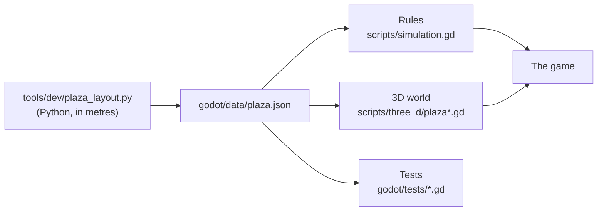

# How Hora Cero was made

*[Versión en castellano](COMO_SE_HIZO.md)*

Hora Cero · Invasión Buenos Aires is a small game made with a lot of care: two levels, a square and a neighbourhood,
one night in 1958. This is how it was made, for players, for modders, and for anyone curious about making games
with an AI.

Figma design kit: [Hora Cero · kit](https://www.figma.com/design/Y03Bhe1LF6GyW3VJMOYqZN)

## Who did what

- **The idea, the direction, the design and every decision**: Alejandro Vizio (Ale).
- **The code, the procedural 3D, the textures, the levels, the tests, the web build and the trailers**: Claude,
  Anthropic's AI, working in Claude Cowork, with Ale reviewing every step and steering. Ale asked, looked, played
  and corrected; Claude wrote, tested and tested again.
- **The models of Juan Salvo, the cascarudo and the vehicles**: friends of Ale, with their permission (below).
- **The comic**: Héctor Germán Oesterheld and Francisco Solano López, published in *Hora Cero Semanal* from 1957. Its
  characters and creatures are used with its rights holders' permission.

The game did not start from nothing: it grew out of the engine of an earlier game of Ale's, a stealth game with a
small squad. The rules engine (`godot/scripts/simulation.gd`), the touch HUD and much of the 3D layer come from
there. Everything else was made for Hora Cero.

## Research first

Before anything was built, there was Buenos Aires in 1958 to learn: the buildings of the Plaza de Mayo and how they
face the square, the trams on Rivadavia with their two tracks, the colectivos, the street signs, the way people
spoke. It went into the game in two ways:

- in the world: the square is the real one, simplified (the Cabildo with its arches and tower, the Catedral with its
  portico of twelve columns, the Casa Rosada, the Banco Nación, the Pirámide, the Belgrano monument, the stairs of
  Línea A of the subte), and La Boca has its tenements, its railway cutting and the transporter bridge;
- in the "real story" pages that open when a level is won (`history` in the level data), with what is true about
  each place. As the foot of one of them says: the night of the snow is made up; the square is not.

No photograph or plan was copied: everything was drawn again from how those places were.

## Levels are programs

Each level is a Python script that writes a data file: `tools/dev/plaza_layout.py` writes `godot/data/plaza.json`,
and `tools/dev/riachuelo_layout.py` writes `godot/data/riachuelo.json`. Everything is there: where every wall,
shelter and lamp stands, who patrols where, when the waves of snow come, when Juan Salvo walks in, the texts. The
script works in metres and converts them to game units (32 a metre). The rule is simple: edit the script, never
the JSON.

Both halves of the game read the same file: the rules (who sees whom, who falls in the snow, what can be opened) and
the 3D world builder. So the scenery and the rules never disagree: if a wall is on the map, it is in the world, in
the same place.

## The world, built in code

There are no hand-modelled scenes. When a level starts, the game builds its world in GDScript from the data:

- **The Plaza de Mayo kit** (`plaza_kit.gd`, `plaza_kit_buildings.gd`, `plaza_kit_props.gd`) puts every landmark
  together from simple pieces: the Casa Rosada, the Cabildo, the Catedral, the Banco Nación, the Pirámide, the
  Belgrano monument, the lamps, palms and benches, and the kit's own tram and colectivo.
- **The city around it** (`plaza_city.gd`) is Buenos Aires blocks running on beyond the map, with the Avenida de
  Mayo and the Diagonal Norte; **the details** (`plaza_details.gd`) are the plates, newspapers, fileteado and café
  tables.
- **La Boca** (`boca.gd`) raises the tenements, the cutting, the bridges, the quay and the transporter bridge with
  its gondola.

It is all merged into a few large meshes, so that a phone can draw it: the square's opening view takes a few hundred
draw calls.

**The weathered Casa Rosada.** It is not one flat paint: it is a lime-stuccoed palace of the 1890s, the stucco
uneven, patched and finely crazed, the cornices and mouldings in pale stone, and time on top of it: a layer of grime a
hair off the walls (`plaza_grime.gdshader`) with rain streaks under every sill and balcony, soot and damp under the
cornices and rising damp at the foot. The stucco's large blotches are drawn in world coordinates
(`plaza_walls.gdshader`), so the repeat never shows across a 96 m front.

**The palms** are Canary Island date palms, like the ones Thays planted in the square early in the 20th century (about
55 years old in 1958, shorter than today): the trunk patterned with the diamonds of old leaf bases, a dense crown of
long arching fronds with the dry ones hanging, and snow on what faces up. When somebody stands under one, its crown
turns see-through so they can be seen (`plaza_palm_ghost.gdshader`), while the trunk stays whole.

**Textures** come out of Python scripts (`tools/gen_plaza_textures.py`, `tools/gen_boca_textures.py` and the other
`tools/gen_*_textures.py`): stone, render, corrugated iron, setts, signs, all painted by code.

**The snow** is mostly shaders: the ground whitening with the rules' clock, grey slush in the busy streets, tracks
that fresh snow fills in (`plaza_ground.gdshader`), drifts against the walls (`plaza_drift.gdshader`), and the
falling flakes, which are not particles but quads in a multimesh moved on the GPU (`plaza_snowfall.gdshader`).

**Comic ink** ("Comic ink" in Settings) is a post-process: one full-screen pass draws outlines and hatching in ink
(`ink_lines.gdshader`) and another prints it all on newsprint (`ink_paper.gdshader`).

## The characters

**The four neighbours** (Hornero, Lechuza, Benteveo and Biguá, named after birds of the Río de la Plata) are the
game's own, like the people in the square, the guards and La Boca's passenger. Their bodies come from MakeHuman's
free (CC0) assets: `tools/mh/mhbake.py` shapes the base mesh for each of them (age, build, face), fits the clothes,
hair and eyes, and brings it onto the game's 19-bone skeleton. Each one's skin is weathered by script (sun, creases,
stubble, grime) over the original texture. There are no recorded animations: `operative.gd` poses the skeleton every
frame from what the rules say (a gait with planted feet, crouching, carrying someone, falling).

The neighbours' painted HUD portraits were made with Figma's image generator, in the style of the rest of the photo atlas.

**Juan Salvo and the cascarudo** are models made by friends of Ale. They come in through the art pack
(`godot/art_pack/`, explained in [ART_PACK.md](ART_PACK.md)), and were worked on for the game without changing what
they are. Without those models the game shows neutral stand-ins and plays the same.

### Juan Salvo, refined

The friends' model is small and angular: about 2,000 triangles of boxes and prisms and a 512 px atlas. It is kept
untouched as the source (`art/juan_salvo/source/`), and `python3 tools/art_pack.py refine-person`
(`tools/person_refine.py`) makes the game's Juan Salvo from it, up to the neighbours' level of detail: the same parts,
silhouette, colours, skeleton and clips, but with arms, legs, hood and coat rounded (the edges that should stay sharp,
like the hem, the soles or the visor, stay sharp), about 15,800 triangles, the atlas redrawn at 2048 px with each
cloth's grain, and occlusion, mud, wear and folds stored in the vertices. In the game he is dressed by the same shader
as the neighbours' clothes (`art_model.gdshader`).

He comes with idle, walk and run clips. The game blends them by his speed and, for what they do not cover, turns his
bones on the fly: crouching, carrying someone over his shoulder, aiming and firing the rifle, being knocked down and
getting up (`rig_person.gd`). He walks at the squad's pace and cadence (about three steps a second, the planted foot
never sliding) and runs only when he really runs.

His HUD portrait is not a drawing: it is a render of the model in the engine, at three-quarters in a street lamp's hard
light (his face is a small drawing on a plate, so the portrait keeps it in shadow and shows the visor and respirator),
put through an oil-paint filter with the background, canvas and colour of the neighbours' portraits, so the five read as
one series (`tools/dev/salvo_portrait.gd` and `salvo_portrait_paint.py`). Nothing is painted over it by hand.

### The cascarudo, on its own legs

The friends' cascarudo is a one-piece sculpt with no skeleton (45,000 triangles). To make it walk,
`python3 tools/art_pack.py rig-creature` (`tools/creature_rig.py`) gives it a skeleton without moving a single vertex:
it finds its six legs from the ground up (each point touching the ground is a foot or a claw's tip), follows the surface
up to where the leg opens out into the body, puts hip, knee and ankle where it bends, and blends the weights smoothly at
every joint so nothing tears. It also stores occlusion (crevices and the underside darker) and convexity (worn edges)
in the vertices. Far off, a copy of about 13,500 triangles with the same skeleton is drawn.

The game works out its gait (`creature_body.gd`): an alternating tripod, like an insect, driven by the ground it really
covers (each foot lifts, swings forward and is set down, and a planted foot never slides), its feet shuffling as it
turns on the spot, its shell breathing, its claws flung up as it rushes and as it rears over someone, a stagger when
shot and, when it dies, a roll onto its back with its legs curling.

### The shell

The cascarudo has a shader of its own (`art_chitin.gdshader`) so that it reads as a beetle's carapace and not as
plastic, without changing its shape or the hue of its colour: a very dark olive-brown, growth ridges, grooves along the
wing cases with their rows of pits, fine pitting, polished on top and matte and dusty in the joints and underneath, the
night reflected in the polish (the dark sky, the city's glow, the snow below), an oil-slick sheen only at grazing angles,
and the wet highlights of the lamps. From the game's camera it is still a dark shape on the snow; close up, its legs and
plates read.

The game's icon is a render of that cascarudo, head on with its claws open, rimmed by the lamps
(`tools/dev/creature_icon.gd`).

## The vehicles

The Línea 60 colectivo and two cars of the time were made by the same friends. The other six cars of the 1940s and
50s (a big sedan, the black and yellow taxi, a coupé, a small saloon, a pickup and a van) were made for Hora Cero with
a script based on the friends' generator (`art/vehicles/source/build_vehicles_1950s.py`). `tools/vehicles.gd` makes
them game-ready: it drops their interiors, simplifies them and lays a cap of snow over them that grows through the
night.

## The icons

The HUD's icons are not drawn: they are 3D objects. An icon studio in Godot (`tools/icons3d/studio.gd`) models and
photographs each one on a transparent background, and `tools/icons3d/finish.py` outlines them and packs them into an
atlas (`godot/assets/ui/icons3d.png`).

## Sounds and voices

- **The sounds** come out of `tools/gen_audio.py`: all synthesised from noise, sines and filters, not a single
  recorded sample.
- **The voices** of the four neighbours are synthetic and copy nobody's voice: each voice was designed from a written
  description with Qwen3-TTS (VoiceDesign), and every line was cloned from that designed voice, in Spanish and in
  English with their accent (`tools/voice_riachuelo.py`, which also picks the best take of each line). The
  passenger's lines were made apart, with Kokoro in English and Qwen3-TTS in Spanish. Where every line came from is
  in `tools/voices/riachuelo/`.
- **The trailers' music** was synthesised from scratch in Python (`tools/trailer/horacero_music.py`): a tango of the
  snow with a bandoneón, strings and a clock, no samples.

## Spanish first

The game speaks River Plate Spanish, with voseo ("tocá", "agachate", "movete"), and English too. Texts are written in
English in the code and their Spanish lives in `godot/locale/es.json`. A test (`godot/tests/lang_es.gd`) reads every
sentence and fails if a "tú", a "vosotros" or a word from Spain ("coche", "gafas", "aquí") slips in.
`python3 tools/i18n_extract.py --check` says when something is left untranslated.

## How it was tested

- **Automated tests**: 14 suites that run without a window (`tools/run_tests.sh`), over 21,000 checks. The rules one
  by one (over 14,000 for the square alone); whole games played by script to a win; the 3D scenes really built; the
  touch HUD end to end; the sounds; the icons; the Spanish; the launch screen.
- **Playtests**: `tools/trailer/horacero_playtest.gd` plays both levels as a person would, from the launch screen,
  taking pictures on the way and flagging anyone stuck or inside a wall. And it was played by hand: the fixes that
  came out of playing (a button stretched by a long label, a hint that did not belong after a shot, the rifle's
  sound) each have their test.

## The web version

It is Godot's web export, with a page of its own (`godot/web/shell.html`). `tools/web_site_build.py` exports it, gives
the page its title and link previews, and cuts the pack into parts of at most 48 MB that the page puts back together
as it loads, so it fits a site deployed from a Git repository. It is made to be served at https://horacero.app/.

## Make your own level

1. Copy `tools/dev/riachuelo_layout.py` (or the square's) and change what you like: walls, guards, objectives,
   texts. The 3D world knows how to build two places, La Boca (`"theme": "boca"`) and the square
   (`"theme": "plaza"`): a new level uses one of them.
2. Run the script so it writes its JSON into `godot/data/` (change the name of the file it writes).
3. Add the level to `LEVELS` in `godot/scripts/missions.gd`, with its `id` and the `path` of its JSON.
4. [GAMEPLAY_API.md](GAMEPLAY_API.md) explains every field of the data, every order and every event of the rules.
   `tests/playthrough_kit.gd` lets you script a game to check that the level can be won.

And to translate it, `python3 tools/i18n_extract.py` lists what is missing.
